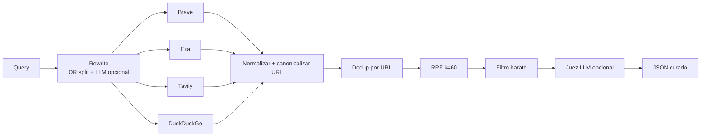

# meta-search-agent

Meta-buscador para agentes de IA: una consulta se dispara en paralelo a varios indexadores web, los resultados se normalizan, deduplican, fusionan con **Reciprocal Rank Fusion (RRF)**, se filtran con heurísticas baratas y, opcionalmente, un LLM cura y puntúa la relevancia.

La motivación es simple: **ningún índice cubre todo**. En benchmarks internos, un solo proveedor ronda ~69% de recall en tareas difíciles; combinar cuatro APIs llegó a ~95%. Cada indexador suma cobertura marginal.

## Arquitectura



## Requisitos

- Python 3.11+
- Para correr sin claves: `duckduckgo-search` (extra `[ddg]`)

## Instalación

```bash
python -m venv .venv
source .venv/bin/activate
pip install -e ".[ddg,dev]"
cp .env.example .env
# Completá las API keys que tengas (opcional)
```

## Uso

### CLI

```bash
meta-search "Python asyncio tutorial"
meta-search "foo OR bar" --no-llm-judge --providers duckduckgo
meta-search "consulta" -v --max-output 10
```

La salida es JSON con `results[]` (url, title, snippet, `providers`, `rrf_score`, y opcionalmente `relevance_score`).

### Librería (para agentes)

```python
import asyncio
from meta_search import search

async def main():
    resp = await search("Rust ownership", use_llm_judge=False)
    for r in resp.results:
        print(r.url, r.providers, r.rrf_score)

asyncio.run(main())
```

O directamente:

```python
from meta_search.search import search_json
import asyncio
print(asyncio.run(search_json("HTTP 404 MDN", use_llm_judge=False)))
```

## Proveedores

| Proveedor   | Variable de entorno | Clave |
|------------|---------------------|-------|
| Brave      | `BRAVE_API_KEY`     | Sí    |
| Exa        | `EXA_API_KEY`       | Sí    |
| Tavily     | `TAVILY_API_KEY`    | Sí    |
| DuckDuckGo | —                   | No    |
| Wikipedia  | —                   | No (API MediaWiki; útil sin claves) |

Cada adapter implementa `SearchProvider` en `src/meta_search/providers/`. Un proveedor **solo se habilita** si su variable de entorno está definida (excepto DuckDuckGo). Timeouts y errores por proveedor no tiran abajo la corrida completa.

### Cómo agregar un proveedor

1. Creá `src/meta_search/providers/mi_proveedor.py` con una clase que herede de `SearchProvider`.
2. Definí `config = ProviderConfig(name="...", api_key_env="MI_KEY" o None)`.
3. Implementá `async def search(self, query, query_variant="") -> list[SearchResult]`.
4. Registrá la clase en `ALL_PROVIDER_CLASSES` en `src/meta_search/providers/__init__.py`.
5. Documentá la variable en `.env.example` y en esta tabla.

## Evaluación

El harness mide **recall por proveedor**, URLs únicas que solo aporta cada uno, y **ganancia marginal** al ir sumando proveedores:

```bash
python eval/run_eval.py
python eval/run_eval.py --timeout 25
```

Las queries etiquetadas están en `eval/queries.yaml`.

## Tests

```bash
pytest
```

## Variables de entorno (LLM)

| Variable           | Uso                                      |
|--------------------|------------------------------------------|
| `OPENAI_API_KEY`   | Reescritura de query y juez (opcional)   |
| `OPENAI_BASE_URL`  | API compatible con OpenAI                |
| `OPENAI_MODEL`     | Modelo (default `gpt-4o-mini`)           |

Sin `OPENAI_API_KEY`, el juez y el rewrite LLM se omiten sin error.

## Licencia

MIT (o la que definas en el repo).
